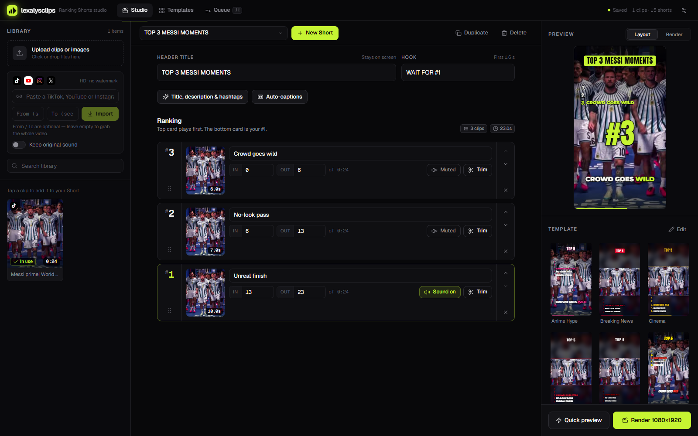
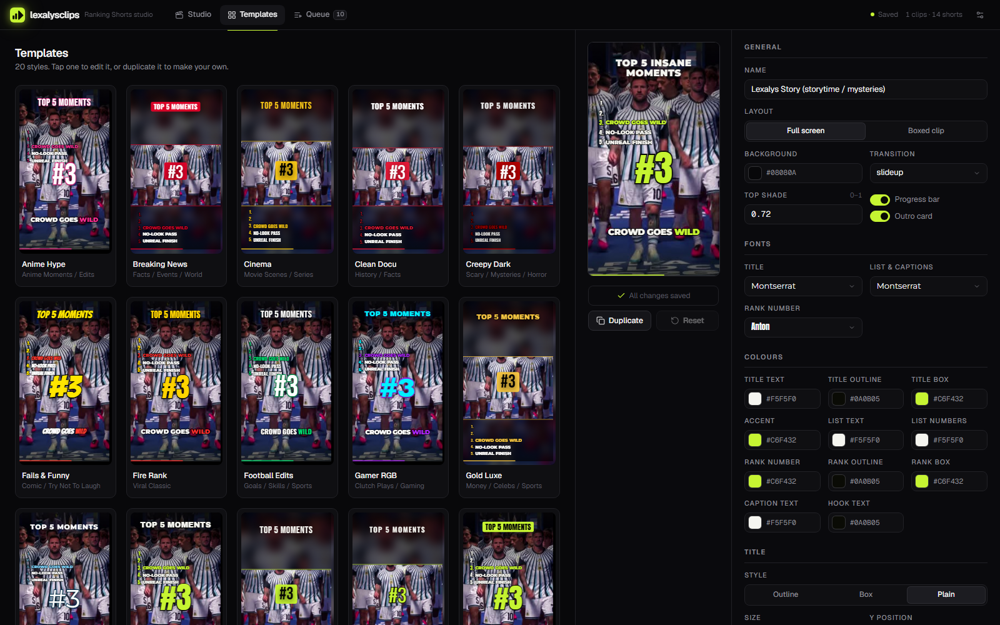
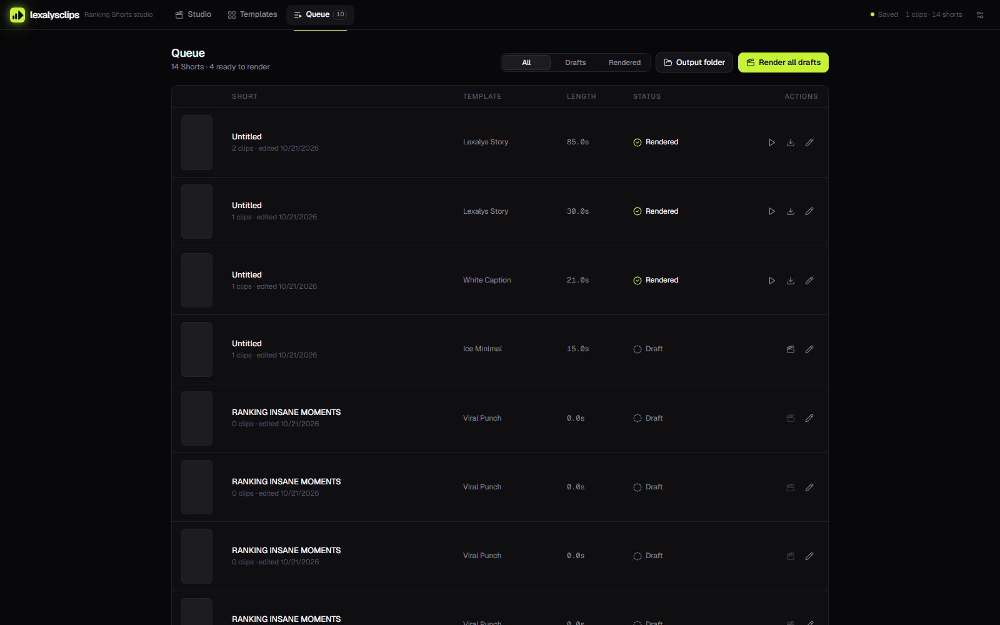

# LexalysClips — AI Video Automation Pipeline

A self-hosted studio that turns a handful of clips into a **viral "Top N" ranking Short** (1080×1920) in a few clicks — animated rank badges, header title + hook, music with auto-ducking, transitions, SFX, burned-in **AI auto-captions** and **AI-generated titles & hashtags**.

Built for my YouTube Shorts channel [@lexalysclips](https://www.youtube.com/@lexalysclips).



## Features

- **Import from links** — paste a TikTok / YouTube / Instagram URL; downloads in HD with no watermark (yt-dlp), optional in/out range.
- **Rank editor** — drag to re-rank, per-clip label, IN/OUT trim, per-clip *Sound on / Muted* (music auto-ducks when a clip's own audio plays).
- **20 templates** — fonts, colours, header style, rank-number style, layout (full screen / boxed), transitions (flash, zoom, glitch, whip, shake, slide-up, cut), progress bar, outro/CTA card. Duplicate and edit your own.
- **AI auto-captions** — word-by-word karaoke captions from clip speech via **Groq Whisper** (`whisper-large-v3-turbo`).
- **AI title, description & hashtags** — via **Groq Llama 3.3 70B**, with a built-in offline generator as fallback.
- **Render queue** — quick low-res preview, full 1080×1920 render, "render all drafts".
- **Password lock** for hosting (signed cookie sessions, per-IP rate limiting).
- Mobile-friendly UI.

| Templates | Queue |
|---|---|
|  |  |

## Tech stack

| Layer | Tech |
|---|---|
| Video engine | **Remotion 4** (React → MP4), FFmpeg |
| Backend | Node.js + **Express** (single `server.js`, job queue + polling API) |
| Frontend | **Next.js 15**, TypeScript, Tailwind CSS v4 (static export served by Express) |
| AI | **Groq** — Whisper (captions) + Llama 3.3 70B (titles/hashtags) |
| Downloads | yt-dlp |
| Process manager | PM2 |

```
server.js            Express API + render/caption/download jobs
auth.js              optional password gate
remotion/            RankReel.tsx — the video composition
web/                 Next.js UI (Studio / Templates / Queue)
data/templates/      starter templates (JSON)
assets/fonts|music|sfx|bin
```

## Getting started

**Requirements:** Node.js 18+, FFmpeg on PATH (or set `FFMPEG_DIR`), Windows for the bundled `yt-dlp.exe` link import.

```bash
git clone https://github.com/FarazAnjamAli/lexalysclips-ai-video-automation-pipeline.git
cd lexalysclips-ai-video-automation-pipeline
npm install
npm --prefix web install
npm run ui:build
npm start              # → http://localhost:4545
```

Optional: `npm i -g pm2 && pm2 start ecosystem.config.js` to keep it running.

Then add assets that aren't in the repo (size/licensing):
- `assets/bin/yt-dlp.exe` — for link import ([how](assets/bin/README.md))
- music in `assets/music/` and SFX in `assets/sfx/` ([music](assets/music/README.md), [sfx](assets/sfx/README.md))

### Enable the AI features (Groq API key)

AI captions and AI titles need a **free** Groq key — get one at <https://console.groq.com/keys>. No key is shipped with this repo; bring your own:

- **Option A:** open the app → **Settings (top-right)** → paste your `gsk_…` key → Save. It is stored server-side in `data/settings.json` (git-ignored) and never sent back to the browser.
- **Option B:** set the environment variable `GROQ_API_KEY` (see `.env.example`).

Without a key everything else works; titles fall back to the built-in generator.

### Password lock (for hosting)

Set `RANKREEL_PASSWORD` (and optionally `RANKREEL_SECRET`) before starting the server. Serve it over HTTPS.

## How a Short is made

1. Add clips (upload or paste a link).
2. **New Short** → header title + hook.
3. Add clips to the ranking — the top card plays first, the bottom card is **#1**.
4. Pick a template, music, caption style.
5. **Auto-captions** / **Title, description & hashtags**.
6. **Quick preview** → **Render 1080×1920**. Output lands in `data/output/`.

## License

Code: [MIT](LICENSE). Fonts in `assets/fonts` are from Google Fonts (SIL Open Font License). Music/SFX are not included.
